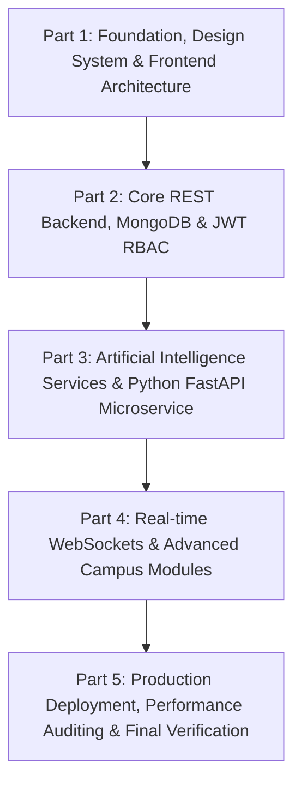
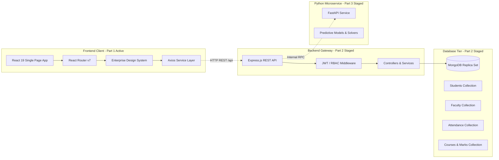

# CampusVerse AI — Intelligent University Management Ecosystem
## System Architecture & Multi-Part Development Roadmap

---

## 1. Executive Project Summary
**CampusVerse AI** is an enterprise-grade digital operating ecosystem designed for modern universities and higher education institutions. The ecosystem provides a unified technological foundation for managing 15 core campus departments, harmonizing academic telemetry, administrative workflows, financial operations, and facility logistics under a secure, role-governed model.

---

## 2. Multi-Part Phased Development Strategy

To maintain rigorous software quality, avoid context limits, and guarantee modular testability, the project is structured across sequential phases:

| Phase | Core Deliverable | Technology Stack | Status |
| :--- | :--- | :--- | :--- |
| **Part 1** | **Foundation, Design System, Responsive Frontend, Demo Role Portals** | React 19, Vite 8, Tailwind CSS v3, React Router v7, Lucide Icons | **COMPLETED & VERIFIED** |
| **Part 2** | Core REST API Gateway, MongoDB Database, Mongoose Models, JWT & RBAC Auth | Node.js, Express.js, MongoDB, Mongoose, bcryptjs, jsonwebtoken | Next Development Phase |
| **Part 3** | AI Reasoning Services, Attendance Risk Early Warning, Timetable Solver | Python 3.11, FastAPI, Uvicorn, Scikit-Learn, PyTorch | Scheduled |
| **Part 4** | Real-time WebSocket Messaging, Push Alerts, Live Transport Telemetry | Socket.io / WebSockets, Redis Cache | Scheduled |
| **Part 5** | Containerization (Docker), Production Hardening, CI/CD Pipeline | Docker, GitHub Actions, Nginx | Scheduled |

---

## 3. High-Level Multi-Tier Architecture

---

## 4. The 15 Planned University Modules

| Mod # | Module Name | Scope & Purpose | Target Phase |
| :---: | :--- | :--- | :---: |
| **M01** | Student Information System (SIS) | Biographic records, degree audits, credit requirements | Part 1 UI / Part 2 DB |
| **M02** | Faculty & Course Management | Faculty workloads, course catalogs, syllabus milestones | Part 1 UI / Part 2 DB |
| **M03** | Academic Attendance Tracking | Biometric logs, class roll calls, <75% threshold alerts | Part 1 UI / Part 2 DB |
| **M04** | Examination & Grading Portal | Continuous assessment, mid-terms, final SGPA/CGPA | Part 1 UI / Part 2 DB |
| **M05** | Fee Collection & Invoicing | Semester tuition, digital invoices, receipt downloads | Part 1 UI / Part 2 DB |
| **M06** | Timetable & Scheduling Matrix | Algorithmic lecture slot, room, and lab management | Part 1 UI / Part 2 DB |
| **M07** | Campus Placement & Recruitment | Corporate partner drives, candidate eligibility, CTC stats | Part 1 UI / Part 2 DB |
| **M08** | Hostel & Room Allotment | Residential wing capacities, bed allocations, warden desk | Part 1 UI / Part 2 DB |
| **M09** | Transport & Fleet Logistics | Bus routes, vehicle fleet schedules, commuter tracking | Part 1 UI / Part 2 DB |
| **M10** | Parent & Guardian Portal | Ward academic telemetry, attendance alerts, fees | Part 1 UI / Part 2 DB |
| **M11** | Grievance & Ticket Redressal | Maintenance, infrastructure, and academic complaints | Part 1 UI / Part 2 DB |
| **M12** | Library & Digital Repository | Book cataloging, digital journal lending, overdue fines | Part 2 Extension |
| **M13** | AI Learning Analytics & Copilot | Predictive dropout early warning, rubric grading assistant | Part 3 (FastAPI) |
| **M14** | Smart Event & Notice Broadcasting | Institutional circulars, hackathons, guest lectures | Part 1 UI / Part 2 DB |
| **M15** | Executive Administration & Audits | Campus headcounts, departmental budgets, compliance | Part 1 UI / Part 2 DB |

---

## 5. The 7 Unified User Roles

1. **Student**: Self-service portal for attendance, course schedule, grades, assignments, fees, and campus notifications.
2. **Faculty**: Course management, attendance rosters, assignment grading rubrics, student mentorship.
3. **Administrator**: Campus-wide metrics, departments, approvals pipeline, grievance ticket dispatch, reports.
4. **Parent / Guardian**: Direct ward telemetry (attendance percentage, exam results, pending fees, faculty advisor contact).
5. **Placement Officer**: Corporate recruiter drives, student eligibility filtering, interview tracking, CTC package analytics.
6. **Hostel & Transport Staff**: Residential room allotment, hostel maintenance dispatch, commuter bus fleet schedules.
7. **Super Administrator**: System diagnostics, audit logs, security policies, 15-module readiness monitoring.

---

## 6. Security & Governance Principles
- **No Client-Side Pseudo-Auth**: Client routing exposes explicit architectural preview modes for design review without pretending that an insecure localStorage token represents real authentication.
- **Strict Separation of Concerns**: Frontend components never make direct database assumptions; all remote access is routed through `src/services/api.js`.
- **Zero Mock Overwrite**: Demonstration data is segregated into `src/utils/demoData.js` and explicitly tagged as demonstration data across the UI.
